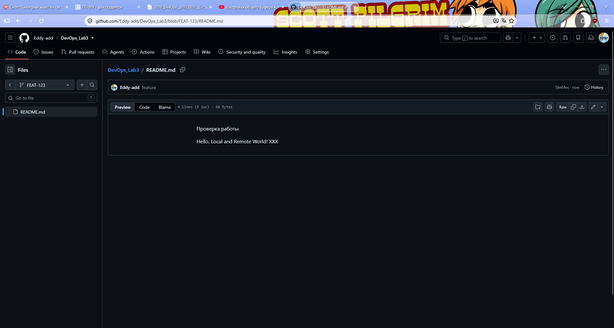

# Отчёт по практической работе №3: Системы контроля версий на примере Git

**Дисциплина:** DevOps  
**Тема:** Системы контроля версий кода (Git), работа с удалённым репозиторием GitHub, ветвление и разрешение конфликтов слияния  
**Выполнил:** [Ваши ФИО / Номер группы]  
**Проверил:** Моисеев Виктор Игоревич  

---

## 1. Цель работы

Изучить принципы работы распределённой системы контроля версий (DVCS) Git:
1. Выполнить установку и первичную глобальную конфигурацию клиента Git на виртуальной машине с ОС Ubuntu.
2. Освоить создание и инициализацию локального репозитория, индексацию изменений и фиксацию коммитов.
3. Настроить безопасную аутентификацию по протоколу SSH между виртуальной машиной и платформой GitHub.
4. Связать локальный и удалённый репозитории, выполнить синхронизацию истории изменений (`push`, `pull`, `fetch`).
5. Смоделировать конфликт слияния (Merge Conflict) при параллельном редактировании одного файла локально и удалённо, а также отработать алгоритм его ручного разрешения.
6. Освоить создание тематических веток (`branch` / `checkout -b`), отправку их в удалённый репозиторий и слияние изменений (`merge`).

---

## 2. Используемое окружение и инструменты

* **Виртуальная машина (гостевая ОС):** Ubuntu Linux (рабочая директория проекта `~/devops_lab3`).
* **Основная ОС (хост):** Windows с веб-браузером для работы с веб-интерфейсом GitHub.
* **Платформа хостинга репозиториев:** GitHub (`github.com`).
* **Инструменты:** `git`, `openssh-client` (`ssh-keygen`, `ssh`), текстовый редактор `nano`.

---

## 3. Ход выполнения работы

### 3.1. Установка и первичная настройка Git на виртуальной машине

На первом этапе в терминале виртуальной машины Ubuntu была проверена установка пакета `git` и заданы глобальные параметры идентификации автора коммитов (`user.name` и `user.email`), которые записываются в метаданные каждого коммита.

Выполненные команды:
```bash
sudo apt update && sudo apt install git -y
git config --global user.name "Ваше Имя"
git config --global user.email "ваш_email@example.com"
git config --list --show-origin

Screenshot From 2026-11-11 17-57-26.

```

